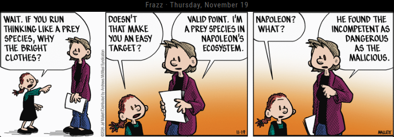

# MMM-Comic

A [MagicMirror²](https://github.com/MagicMirrorOrg/MagicMirror) module that shows the newest
**Calvin and Hobbes** or **Frazz** comic strip. It can also flip through the last couple of weeks
of strips.

## Screenshots

**Calvin and Hobbes** (`type: "calvin"`)


**Frazz** (`type: "frazz"`)



---

## Requirements

- MagicMirror² 2.3x (Node 18 or newer)
- An internet connection. The strips come from the free comic feeds at
  [persistent.info](http://persistent.info/scraped/), which pick up the daily strips from GoComics.
  No account or API key needed.

## Install

```bash
cd ~/MagicMirror/modules
git clone https://github.com/cowboysdude/MMM-Comic
```

**Do I need to run `npm install`?** No. The module has no dependencies.

## Add it to your config

In `~/MagicMirror/config/config.js`, inside `modules: [ ... ]`:

```js
{
  module: "MMM-Comic",
  position: "bottom_bar",
  config: {
    type: "calvin"
  }
},
```

Restart MagicMirror to see it. It works in any position. In the left or right column it lines up
with that side, and anywhere else it's centered.

## Options

| Option | Default | What it does |
|---|---|---|
| `type` | `"calvin"` | Which comic: `"calvin"` (Calvin and Hobbes) or `"frazz"`. |
| `maxWidth` | `"800px"` | How wide the strip can get. Make it smaller (for example `"500px"`) to save space. |
| `showTitle` | `true` | Show the comic name and date above the strip. |
| `rotate` | `false` | `true` flips through the recent strips (about two weeks' worth) instead of showing only the newest. |
| `rotateInterval` | `1800000` (30 min) | With `rotate: true`, how long each strip stays up, in milliseconds. |
| `updateInterval` | `3600000` (1 hour) | How often to check for a new strip, in milliseconds. |
| `grayscale` | `false` | `true` shows the strips in black and white (the Sunday strips are in color). |
| `feedUrl` | none | Advanced: use any other comic feed from [persistent.info/scraped](http://persistent.info/scraped/) instead of `type`. |

Want both comics? Add the module twice, one with `type: "calvin"` and one with `type: "frazz"`.

## Good to know

- A new strip shows up once a day. The feed usually has it by the next morning.
- If the feed can't be reached, the module keeps showing the last strip it got and tries again
  every 5 minutes.

## Troubleshooting

| What you see | What to do |
|---|---|
| `type must be "calvin" or "frazz"` | Check the spelling of `type` in your config. |
| "Comic not available right now" | Check the mirror's internet connection. It keeps trying on its own. |
| Strip is too big or too small | Change `maxWidth`, for example `maxWidth: "600px"`. |

## What changed in v2

- Works again with current MagicMirror.
- No more `npm install`. The old `request` and `xml2js` packages are gone.
- Shows the newest strip by default, with the comic name and date. `rotate: true` flips through
  recent strips.
- The size is set with `maxWidth`, so there's no need for custom CSS.
- Each module instance can show its own comic.

## Credits

Created by **cowboysdude**. Calvin and Hobbes © Bill Watterson. Frazz © Jef Mallett. Strips are
distributed by Andrews McMeel Syndication through GoComics. Feeds by persistent.info. MIT License.
